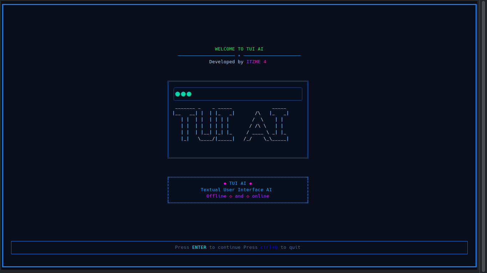
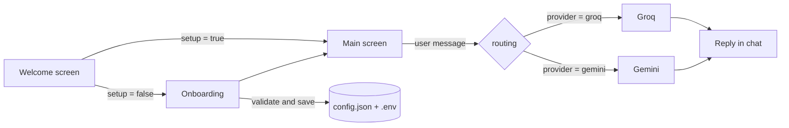

<div align="center">



**An AI assistant that lives inside your terminal.** Chat with cloud models today, local models soon.


</div>


## Table of contents

[Current phase](#-current-phase) · [Features](#-features) · [Screenshots](#-screenshots) · [Live demo](#-live-demo) · [Quick start](#-quick-start) · [Configuration](#-configuration) · [How it works](#-how-it-works) · [Project structure](#-project-structure) · [Roadmap](#-roadmap--future-updates) · [Known limitations](#-known-limitations)


## 📍 Current phase

> **Phase 1: Foundation (Alpha, v0.1).**
> The app starts, onboards a new user, validates input, and talks to an online AI provider. Quick-access tools, offline mode and chat memory are the next milestones.


<sub>Percentages are rough estimates of how complete each area is, not measured metrics.</sub>

## ✨ Features

**Working now**

- **Welcome screen** with an ASCII logo and a one-key start (`Enter` to continue, `Ctrl+Q` to quit).
- **First-run onboarding** (AI name, your name, location, 12/24-hour clock, provider, model, API key).
  - Every field is validated; an empty field shows an error notification and moves focus to it.
  - When setup finishes, the app switches straight to the main screen.
- **Main screen** with a live status bar (CPU, RAM, battery, time, date), a quick-access tree, a chat panel and a terminal input box.
- **Online AI** through **Groq** or **Google Gemini**, selected in `config.json`.
  - Replies are fetched in a background thread, so the UI never freezes; a "Thinking..." placeholder is replaced by the answer.
  - API errors are shown in the chat as plain text instead of crashing the app.
- **Safe rendering**: `[brackets]` in AI replies can no longer break the Rich markup.
- API key saved to a local `.env` (git-ignored) and picked up without restarting.

**Stubbed (UI exists, logic not wired yet)**: Quick-access items (TODO, Web Search, Weather, Open Apps, Tools, Files, Commands, User Info) and the Terminal Input box.

## 🖼 Screenshots

<table>
<tr>
<td width="50%"><b>Welcome</b><br/></td>
<td width="50%"><b>Onboarding</b><br/></td>
</tr>
<tr>
<td colspan="2"><b>Main screen (real AI reply)</b><br/></td>
</tr>
</table>

## 🎬 Live demo

<div align="center">

</div>

<sub>This animation is a simplified illustration of the chat flow, not a recording of a real session.</sub>

## 🚀 Quick start

**Requirements:** Python **3.12 or newer** and an API key for [Groq](https://console.groq.com/keys) or [Google AI Studio](https://aistudio.google.com/app/apikey).

```bash
# 1. clone
git clone <your-repo-url> TUI_AI
cd TUI_AI

# 2. virtual environment
python -m venv .venv
source .venv/bin/activate          # Windows: .venv\Scripts\activate

# 3. install
pip install -r requirements.txt

# 4. run (from the src folder)
cd src
python -m tui_ai
```

On first launch the onboarding screen asks for your details and API key and creates the `.env` for you.
Run the app from the same folder every time (`src/`), because `.env` is created and read relative to where you start it.

**Keys:** `Enter` continue · `Tab` move between fields · `Ctrl+Q` quit

## ⚙ Configuration

| File | What it holds |
| --- | --- |
| `src/tui_ai/database/onboardingconfig.json` | Your names, location, clock format and the `setup` flag. Set `"setup": false` to see onboarding again. |
| `src/tui_ai/database/config.json` | `mode`, `provider` (`groq` or `gemini`), `model` and `ollama_model`. |
| `.env` | `GROQ_API_KEY` / `GEMINI_API_KEY`. **Never commit this file.** |

```json
{
  "mode": "online",
  "provider": "groq",
  "model": "openai/gpt-oss-120b",
  "ollama_model": ""
}
```

## 🧠 How it works



1. `MainScreen` sends your message to `routing()` in a background worker thread.
2. `routing()` reloads `config.json` and `.env`, then calls the chosen provider.
3. The provider function always returns a plain string (reply or error), which is rendered in the chat panel.

## 🗂 Project structure

```text
TUI_AI/
├── assests/                  # banner, screenshots, animated SVGs used by this README
├── requirements.txt
├── pyproject.toml
└── src/
    └── tui_ai/
        ├── __main__.py       # entry point
        ├── app.py            # Textual App
        ├── AI/
        │   ├── routing.py    # picks provider/model from config
        │   ├── online.py     # Groq + Gemini calls
        │   └── offline.py    # (planned) Ollama
        ├── core/config.py    # paths to the JSON files
        ├── database/         # config.json, onboardingconfig.json
        ├── screens/          # WelcomeScreen, OnboardingScreen, MainScreen
        ├── services/         # save_api_key.py, chat_service.py (planned)
        ├── styles/           # .tcss stylesheets
        └── util/             # greeting, JSON helpers
```

## 🗺 Roadmap / Future updates

**Phase 1: Foundation (current)**
- [x] Welcome screen
- [x] Onboarding flow with field validation and notifications
- [x] Main screen layout and live status bar
- [x] Online AI via Groq and Gemini (non-blocking)
- [x] Onboarding hands off to the main screen
- [ ] Wire the Terminal Input box
- [ ] Fix "TUI RBA" / "TUI_RBA" leftovers in the UI to the final name

**Phase 2: A smarter chat**
- [ ] Conversation memory (send previous messages with each request)
- [ ] Chat history saved to disk and restored on start (`chat_service.py`)
- [ ] Streaming replies (text appears as it is generated)
- [ ] Markdown and code-block rendering in answers
- [ ] Slash commands such as `/clear`, `/model`, `/provider`
- [ ] Switch provider and model from inside the app

**Phase 3: Offline mode**
- [ ] Local models through **Ollama** (`offline.py`)
- [ ] "Both" mode: use online when connected, fall back to offline
- [ ] Model picker that lists installed Ollama models

**Phase 4: Quick-access tools**
- [ ] TODO app
- [ ] Web search
- [ ] Weather
- [ ] Open apps / system files
- [ ] System commands (exit, reboot, shutdown) with confirmation
- [ ] User info panel

**Phase 5: Polish and release**
- [ ] Theme switcher and custom colors
- [ ] Keyboard shortcut help screen
- [ ] Automated tests
- [ ] Packaging so `tui-ai` runs as a command (`pip install .`)
- [ ] Release on PyPI

> Roadmap items are plans, not promises; their order may change.

## ⚠ Known limitations

- Offline and "both" modes are blocked during onboarding (a notification explains why).
- Quick-access tree items and the Terminal Input box are placeholders for now.
- Each message is sent on its own, so the AI does not remember earlier turns yet.
- The app must be started from `src/` so the `.env` file is found.

## 🔐 Security note

Your API keys live only in `.env`. It is listed in `.gitignore`; double-check that it never gets pushed, and rotate any key that was shared by accident.

## 👤 Credits

Developed by **ITZME 4**. Built with [Textual](https://textual.textualize.io/), [Groq](https://groq.com/) and [Google Gemini](https://ai.google.dev/).

<div align="center">


<sub>Made with ❤ in the terminal</sub>

</div>